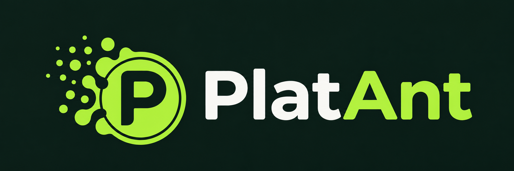

  

# PlatAnt

App de finanzas personales enfocada en personas que reciben sus pagos quincenalmente, pero que gran parte de sus gastos se cobran mensualmente.

En esta app buscamos ayudar a estas personas a manejar de mejor manera su dinero, identificando gastos hormiga y malas prácticas por medio de IA, la cual diariamente hace un análisis y te da recomendaciones.

La app responde tres preguntas principales:

- **¿Cuánto tengo?** En la cuenta y en efectivo.
- **¿Cuánto puedo gastar hoy?** Lo que queda libre después de apartar los compromisos de la quincena.
- **¿A dónde se me va la plata?** Incluidos los gastos pequeños que se repiten y uno cree que no se notan, es decir, los gastos hormiga.

## Derechos

© 2026 Santiago Vélez. Todos los derechos reservados.

El código es público para que se pueda ver, pero no es de código abierto: no se concede permiso para copiarlo, modificarlo ni distribuirlo.
